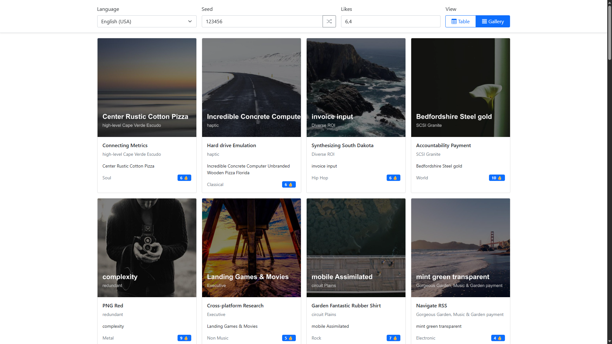

# Setup

## Clone Repository
```
git clone https://github.com/AGR-ALS/MusicStoreService.git
cd MusicStoreService/
```

## Enter enviromental variables

Create `.env` files and write variables into them according to `.env_examples` files. 

For example:
```
DeepLTranslationSettings__ApiKey="your_api_key"
```

## Launch the App
### On Windows
```
docker build -t music-service . ; docker run -p 8080:8080 -d --name music-service --env-file .env music-service
```

### On Linux
```
docker build -t music-service . && docker run -p 8080:8080 -d --name music-service --env-file .env music-service
```

### You can access the app at [localhost:8080](http://localhost:8080)


# Key Features


## Core Concept: Database-less Architecture
- **Procedural Generation:** The entire music catalog (songs, covers, audio, lyrics, and reviews) is generated on the fly. No database is used to store media or metadata.
- **Deterministic Output:** Everything is driven by a **Seed** number. The same seed will always produce the exact same catalog of songs, ensuring reproducibility.
- **Dynamic Global Controls:** Users can change the Seed, Average Likes, and Language in real-time, instantly regenerating the entire storefront.

## Procedural Content Generation
- **MIDI Music Composition:** Generates 3-layer musical tracks (bassline, chords, and melody) based on random major/minor scales, root notes, and tempos using `Melanchall.DryWetMidi`.
- **Dynamic Cover Art:** Programmatically generates album covers by downloading placeholder images, adjusting brightness, and overlaying custom typography (album title and artist name) using `SixLabors.ImageSharp`.
- **Synchronized Lyrics:** Generates fake lyrics with precise timecodes calculated from the track's BPM and bar structure, enabling perfect synchronization.
- **Realistic Like Distribution:** Calculates song popularity using a normal distribution (Box-Muller transform) with an asymmetric boost to simulate realistic user engagement.

## Multilingual Support
- **DeepL API Integration:** Translates all generated content (titles, artists, albums, genres, lyrics, and reviews) into multiple languages.
- **Optimized Batch Translation:** Uses parallel execution to translate arrays of text simultaneously, ensuring fast language switching.

## Frontend & User Experience

- **Dual View Modes:** Switch seamlessly between a detailed **Table View** and a visual **Gallery View**.
- **Lazy Loading:** Song details (audio files, cover images, and reviews) are loaded on-demand only when the user expands a row, optimizing initial page load performance.
- **In-Browser MIDI Playback:** Plays the generated MIDI files directly in the browser using `Tone.js` and `@tonejs/midi`.
- **Karaoke-Style Lyrics:** Displays lyrics synchronized with the audio playback using the generated timecodes.

## Infrastructure & Architecture
- **Clean Architecture:** Built with .NET 9 and ASP.NET Core MVC, strictly following Clean Architecture principles (Domain, Application, Infrastructure, Main).
- **Fully Containerized:** Packaged in a custom Docker image that automatically installs system fonts (Arial) during the build process to ensure consistent cover art generation across environments.
- **Custom JSON Serialization:** Includes a custom `JsonConverter<TimeSpan>` for seamless serialization of lyric timecodes between the backend and frontend.